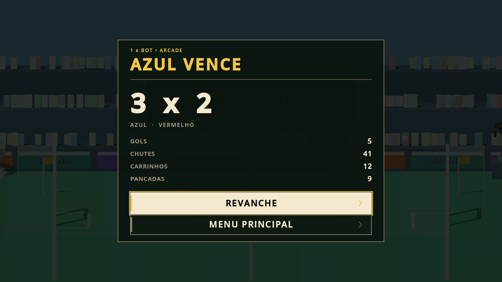
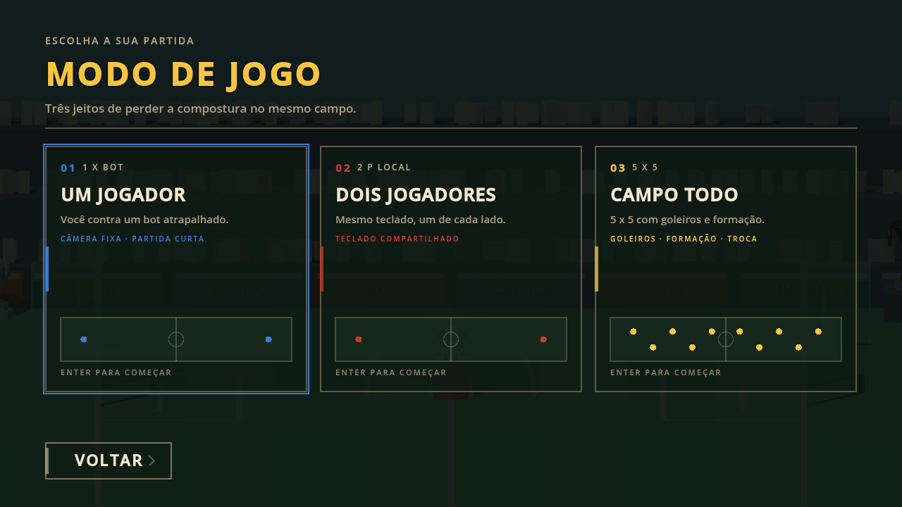
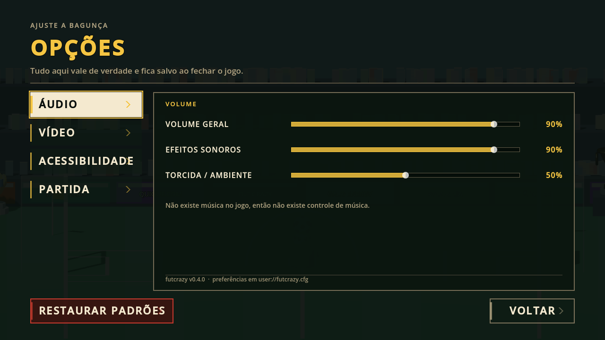
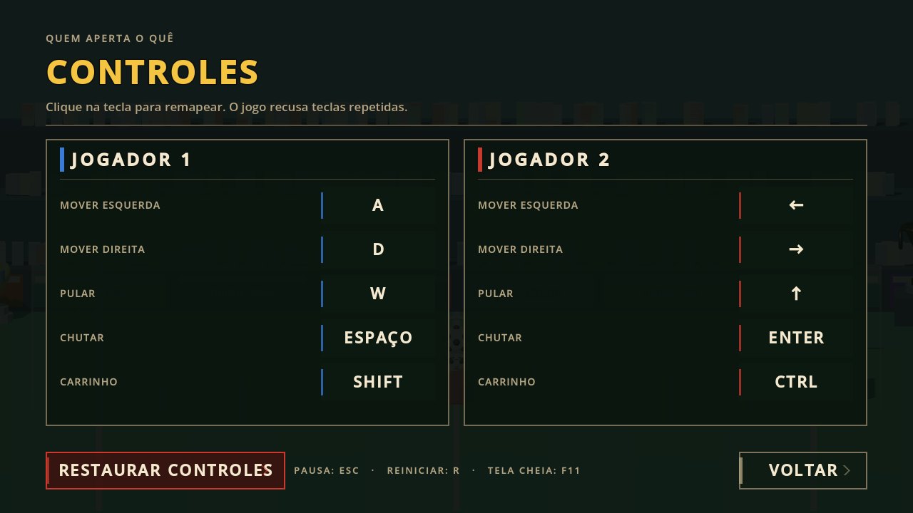

# FutCrazy 🥅

> **Não é um simulador de futebol. É um jogo de comédia física cujo cenário é uma partida de futebol.**

Godot 4.6 · física livre estilo Gang Beasts · 2.5D (profundidade travada) · 10 eventos caóticos ·
áudio sintetizado · campo todo com 5x5 e goleiros · interface própria de cartaz de várzea.

| | | |
| --- | --- | --- |
|  |  |  |
| Menu principal | Campo todo: 5x5 com goleiros | Fim de partida com estatísticas |

| | | |
| --- | --- | --- |
|  |  |  |
| Seleção de modo | Opções (valem de verdade) | Controles com remapeamento |

## Modos

| Modo | Como entrar | O que é |
| --- | --- | --- |
| **1 x BOT** | `JOGAR` → `UM JOGADOR` | campo curto, câmera fixa, você contra um bot atrapalhado |
| **2 JOGADORES** | `JOGAR` → `DOIS JOGADORES` | mesmo teclado, campo curto, um de cada lado |
| **CAMPO TODO** | `JOGAR` → `CAMPO TODO` | 5x5 com goleiros, formação, troca automática de jogador e câmera aberta |

No campo todo você controla sempre **o jogador azul mais perto da bola** (uma seta amarela
marca quem está na sua mão). Os outros quatro, incluindo o goleiro, jogam sozinhos: o mais
próximo persegue, o resto mantém a formação deslocando com a bola.

## Rodar

```bash
godot --path .          # abre o jogo no menu
godot -e --path .       # abre no editor (a cena mostra o estádio, veja "Depurar")
```

Requisitos: **Godot 4.6** (projeto declara `config/features = 4.6`), renderer GL Compatibility.

## Controles

As teclas abaixo são o padrão — todas as cinco ações de cada jogador podem ser
**remapeadas** em `CONTROLES` (o jogo recusa teclas repetidas e teclas reservadas).

| Ação | Jogador 1 (AZUL) | Jogador 2 (VERMELHO, 2P) |
| --- | --- | --- |
| Mover | `A` / `D` (no 1P também setas) | `←` / `→` |
| Pular | `W` (no 1P também `↑`) | `↑` |
| Chutar | `ESPAÇO` | `ENTER` |
| Carrinho / soco | `SHIFT` | `CTRL` |

Fixos: `ESC` pausa · `R` reinicia · `F11` tela cheia · `ENTER` confirma · `ESC` volta.

A dica de controles no rodapé da partida é gerada a partir das teclas configuradas, então
remapear não deixa a ajuda mentindo.

Partida de 2 minutos (configurável). Chutar forte empurra quem chutou; pancada derruba e
atordoa; o corpo é a piada.

## Interface

Todas as telas usam a mesma identidade: verde escuro de campo, creme envelhecido, amarelo de
arbitragem, tipografia pesada de cartaz e formas de canto vivo. Tudo é desenhado por código
(`scripts/ui/`), sem imagens de UI, fontes externas ou ícones de terceiros.

- **Menu principal** — marca, tagline, `JOGAR`, `OPÇÕES`, `CONTROLES`, `CRÉDITOS`, `SAIR`,
  versão discreta no rodapé e o estádio 3D ao fundo.
- **Seleção de modo** — três cartões com nome, descrição, característica, contagem de
  jogadores, mini-campo desenhado e estado de seleção visível.
- **Opções** — quatro abas com controles que realmente mudam o jogo (veja abaixo).
- **Controles** — teclas de cada jogador, remapeamento real com validação de conflito e
  restauração do padrão.
- **Pausa** — `CONTINUAR`, `REINICIAR PARTIDA`, `CONTROLES`, `OPÇÕES`, `VOLTAR AO MENU`,
  com confirmação para o que descarta a partida. O relógio e a física param de verdade.
- **Resultado** — vencedor, placar, gols, chutes, carrinhos e pancadas, com revanche.
- **HUD** — placar de transmissão (time / número / time) com aba de cronômetro, tarja de
  modo, banner de evento com cor, fichas de eventos ativos com tempo restante e rodapé de
  controles.

Navegação por mouse e teclado: setas/`TAB` movem o foco, `ENTER` confirma, `ESC` volta,
com feedback visual e sonoro em cada estado (normal, hover, pressionado, foco, desabilitado).

## Opções (todas funcionam)

As preferências vivem em `user://futcrazy.cfg` (ConfigFile) e continuam salvas depois de
fechar o jogo. `RESTAURAR PADRÕES` pede confirmação antes de apagar tudo.

| Aba | Opção | O que muda de fato |
| --- | --- | --- |
| ÁUDIO | volume geral / efeitos / torcida | volume dos buses `Master`, `SFX` e `Ambience` |
| VÍDEO | tela cheia, VSync, escala da interface | modo da janela, sincronia vertical e `content_scale_factor` |
| ACESSIBILIDADE | tremor, flashes, partículas | multiplica o shake da câmera, o flash de tela e liga/desliga a poeira |
| PARTIDA | duração (1/2/3 min), ritmo dos eventos, dificuldade dos bots | tempo de jogo, intervalo/combos dos eventos e a agressividade da IA |

Não existe controle de música porque o jogo não tem música — só efeitos e a ambiência do
estádio. O ritmo dos eventos vai de `RARO` (17–27 s entre eventos) a `CAOS` (5,5–8,8 s, 60%
de chance de combo). A dificuldade dos bots muda a perseguição, a chance de carrinho e a
frequência com que o bot se atrapalha.

## Eventos

A cada 10–16 s (padrão) a partida avisa (`PREPARE-SE`) e ativa um evento por tempo limitado.
Há 35% de chance de **dois ao mesmo tempo**, e o evento **continua valendo depois do gol**.

| Evento | Efeito |
| --- | --- |
| PERNAS GIGANTES | pernas 3x maiores, alcance e potência de chute absurdos |
| CABEÇÃO | cabeça enorme com colisor real, cabeçadas fortes, equilíbrio péssimo |
| BOLA DE BORRACHA | bola muito mais elástica, leve e rosa |
| CAMPO DE TRAMPOLIM | chão e jogadores quicando sem parar |
| VELOCIDADE ABSURDA | todo mundo 2x mais rápido e difícil de controlar |
| BRIGA GENERALIZADA | `SHIFT` vira soco; a bola fica no campo, mas ninguém quer jogar |
| INVASÃO DOS GIGANTES | um jogador aleatório vira um gigante |
| GRAVIDADE LUNAR | todo mundo flutua, pulos longos, bola demora a cair |
| CAMPO INCLINADO | o gramado entorta e tudo é puxado para um lado |
| MINIATURAS | todo mundo encolhe e a bola vira um planeta |

Cada evento liga e desliga **só o que ligou** (modificadores multiplicativos por id), então
combinações não brigam e nada fica residual ao acabar o tempo, reiniciar ou voltar ao menu.

## Áudio

Todos os sons são sintetizados por `tools/gen_audio.py` (Python puro): chute, pancada,
quique, whoosh, apito, gol com torcida, vinheta de evento, beeps, slide, gravidade lunar,
tremor, guincho e uma ambiência de estádio em loop cuja intensidade acompanha a partida.
Nenhum asset externo.

Efeitos tocam no bus `SFX` e a torcida no bus `Ambience`; os dois mandam para `Master`, que é
o que os sliders controlam. Ao encerrar, `Sfx.shutdown()` para todos os players, solta as
referências de stream e o jogo espera o AudioServer reciclar os playbacks antes de sair —
sem os avisos de `AudioStreamWAV`/`AudioStreamPlaybackWAV` vazados que existiam antes.

```bash
python3 tools/gen_audio.py            # regera assets/audio/*.wav
godot --headless --path . --import    # reimporta no Godot
```

## Depurar

`main.tscn` tem uma hierarquia real e inspecionável no editor:

```
Main  (game.gd)
├─ WorldEnvironment   céu e luz ambiente
├─ Camera             ortográfica, enquadramento do campo
├─ Stadium  (stadium.gd)
├─ Ball     (ball.gd)
├─ Sfx      (audio.gd)
├─ Events   (event_manager.gd)
├─ Hud      (ui/hud.gd)
└─ Menu     (ui/menu.gd)
```

`game.gd` referencia esses nós por caminho tipado (`@onready var ball: Ball = $Ball`), então
renomear um nó na cena quebra na hora, não em silêncio.

- **Jogadores** são criados em tempo de execução (2 ou 10 conforme o modo). Com o jogo
  rodando, use **Depurador → Árvore de cena remota** e procure `T0_field_0`, `T1_gk_0`, etc.
- **Estádio procedural**: a geometria aparece quando o jogo roda; no editor você inspeciona
  o nó e a câmera. `game.gd`, `stadium.gd` e `ball.gd` são `@tool` para a prévia no editor.
- **F6** roda a cena aberta — `main.tscn` (jogo), `scenes/dev/ui_gallery.tscn` (todas as
  telas de UI) e `scenes/dev/sandbox.tscn` (entra direto em um modo).

Guia completo com breakpoints, visualização de colisões, monitores, profiler e receitas:
[`docs/DEVELOPMENT.md`](docs/DEVELOPMENT.md).

## Testes automatizados

```bash
godot --headless --path . -- --smoke        # arcade: 10 eventos, gol, tempo ereto, modo 2P
godot --headless --path . -- --smoke-campo  # campo todo: 10 jogadores, 2 goleiros, evento, gol
godot --headless --path . -- --smoke-ui     # UI: menu, modos, pausa, resultado, revanche,
                                            # persistência, conflito de teclas, limpeza de
                                            # eventos e encerramento do áudio
```

Saem com código 1 em caso de falha e imprimem um resumo (`RESULTADO: OK`). O teste de UI
passa pelos fluxos reais de tela e estado, sem depender de teclado ou de sorte da física.

Ferramentas de captura (salvam `.preview/preview.png`):

```bash
godot --path . -- --shot         # jogo arcade em câmera lenta
godot --path . -- --shot-campo   # campo todo
godot --path . -- --shot-menu    # menu principal
godot --path . -- --shot-modes   # seleção de modo
godot --path . -- --shot-options # opções
godot --path . -- --shot-controls# controles
godot --path . -- --shot-credits # créditos
godot --path . -- --shot-pause   # pausa
godot --path . -- --shot-result  # fim de partida
```

## Estrutura

```
main.tscn                     cena principal (hierarquia explícita de nós)
scenes/dev/ui_gallery.tscn    todas as telas de UI, executável com F6
scenes/dev/sandbox.tscn       herda main.tscn e entra direto no 5x5 (F6)
project.godot                 versão, autoload Settings, GL Compatibility
scripts/game.gd               modos, estados, gols, kickoff, câmera, integração de UI, testes
scripts/settings.gd           configurações + persistência + InputMap (autoload Settings)
scripts/player.gd             corpo físico, chute, carrinho, stun, papéis (linha/goleiro)
scripts/ball.gd               bola com colisões, rastro e modificadores de evento
scripts/bot_brain.gd          IA de linha, goleiro e níveis de dificuldade
scripts/stadium.gd            estádio procedural dimensionado pelo campo
scripts/audio.gd              pool de efeitos + torcida em loop, buses e shutdown
scripts/fx.gd                 poeira e rastro (CPUParticles3D)
scripts/cfg.gd                dimensões e regras globais
scripts/event_manager.gd      aviso → ativação → duração → limpeza (+ combos e fichas do HUD)
scripts/events/*.gd           um arquivo por evento
scripts/ui/menu.gd            menu, modos, opções, controles, créditos, pausa, resultado
scripts/ui/hud.gd             placar, cronômetro, banner, fichas de evento, mensagens
scripts/ui/ui_theme.gd        paleta, tipografia e caixas da identidade visual
scripts/ui/fc_button.gd       botão com todos os estados visuais
scripts/ui/fc_poster.gd       fundo de cartaz desenhado por código
scripts/ui/fc_logo.gd         marca (bola vetorial + wordmark)
scripts/dev/ui_gallery.gd     galeria de telas (ferramenta de desenvolvimento)
tools/gen_audio.py            síntese de todos os sons
tools/blender/                geração dos modelos GLB
docs/DEVELOPMENT.md           guia de desenvolvimento e depuração
.github/workflows/ci.yml      importação + testes headless
```

### Adicionar um evento

1. Crie `scripts/events/meu_evento.gd` estendendo `GameEvent`.
2. No `apply()`, ligue o efeito (`player.add_modifier(id, {...})`, `ball.add_modifier`, `game.xxx`).
3. No `clear()`, desligue **só** o que você ligou; se mexeu na dica do HUD, chame `game.restore_hint()`.
4. Registre o script no `POOL` de `event_manager.gd`.

O gerenciador cuida de aviso, duração, combinação, limpeza e das fichas do HUD. Em caso de
dúvida, o evento não deve depender de quantos jogadores existem: itere sempre `game.players`.

## Decisões de design

- **2.5D**: rigid bodies 3D com Z travado e rotação só no plano da tela — física de verdade,
  leitura de arcade.
- **Corpo como piada**: caixa de colisão com centro de massa baixo + torque de reequilíbrio;
  chutar forte empurra quem chutou.
- **Campo todo é opcional**: o campo curto continua sendo o modo mais legível; o 5x5 existe
  para sentir a partida de futebol com time, goleiro e lateral.
- **Eventos independentes**: modificadores multiplicativos por id, sem conflito entre combos.
- **UI por código, identidade única**: componentes reutilizáveis (`FcButton`, `FcPoster`,
  `FcLogo`) e um tema só (`UiTheme`) em vez de `.tscn` por tela. Facilita os testes headless,
  que exercitam as telas de verdade; o custo é montar a árvore em `_ready()`.

## Compatibilidade

O projeto declara e é testado na **Godot 4.6** (a versão disponível no ambiente de
desenvolvimento e no CI: 4.6.3). A documentação anterior citava 4.6 em alguns lugares e o
`project.godot` declarava 4.7 em outros; agora tudo aponta para 4.6. A 4.7.2 sugerida na
issue não foi verificada aqui, então não é exigida por enquanto.

## Licença

**Pendente de decisão do proprietário.** O repositório ainda não tem um arquivo `LICENSE`, e
este trabalho não escolhe uma licença por conta própria. Enquanto não houver decisão, trate o
código como "todos os direitos reservados". Nenhum asset de terceiros foi adicionado, então a
escolha fica livre (MIT/Apache-2.0 para o código são as opções mais simples). Veja
[`ASSET_LICENSES.md`](ASSET_LICENSES.md).

## Roadmap

- Humanoide articulado no Blender + ragdoll real (`PhysicalBoneSimulator3D`), como protótipo
  isolado antes de substituir o corpo atual.
- Áudio por evento (hoje há uma vinheta única) e gritos da torcida por time.
- Multiplayer online (fora de escopo por enquanto).
- Modos extras: primeiro a 5, sobrevivência, treino de chute.
- Presets de exportação para Windows e Linux.

## Contribuindo

Gitflow + gitmoji em [`CONTRIBUTING.md`](CONTRIBUTING.md). Antes de abrir PR, rode os três
testes headless. Assets e licenças em [`ASSET_LICENSES.md`](ASSET_LICENSES.md); regras de
design em [`docs/GDD.md`](docs/GDD.md); histórico em [`CHANGELOG.md`](CHANGELOG.md).
