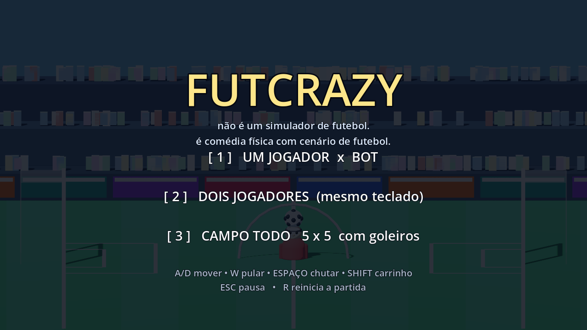
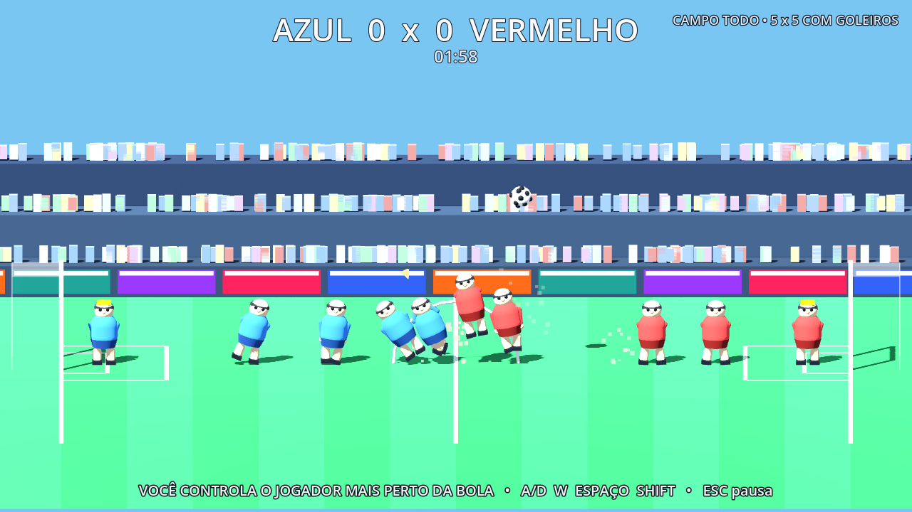

# FutCrazy 🥅

> **Não é um simulador de futebol. É um jogo de comédia física cujo cenário é uma partida de futebol.**

Godot 4.6 · física livre estilo Gang Beasts · 2.5D (profundidade travada) · 7 eventos caóticos ·
áudio sintetizado · campo todo com 5x5 e goleiros.

| | |
| --- | --- |
|  |  |
| Menu inicial: arcade, 2 jogadores ou campo todo | Campo todo: 5x5 com goleiros e formação |

## Modos

| Modo | Como entrar | O que é |
| --- | --- | --- |
| **1 x BOT** | `1` no menu | campo curto, câmera fixa, você contra um bot atrapalhado |
| **2 JOGADORES** | `2` no menu | mesmo teclado, campo curto, um de cada lado |
| **CAMPO TODO** | `3` no menu | 5x5 com goleiros, formação, troca automática de jogador e câmera aberta |

No campo todo você controla sempre **o jogador azul mais perto da bola** (uma seta amarela
marca quem está na sua mão). Os outros quatro, incluindo o goleiro, jogam sozinhos: o mais
próximo persegue, o resto mantém a formação deslocando com a bola.

## Rodar

```bash
godot --path .          # abre o jogo no menu
godot -e --path .       # abre no editor (a cena mostra o estádio, veja "Depurar")
```

Requisitos: Godot 4.6, renderer GL Compatibility.

## Controles

| Ação | Jogador 1 (AZUL) | Jogador 2 (VERMELHO, 2P) |
| --- | --- | --- |
| Mover | `A` / `D` (no 1P também setas) | `←` / `→` |
| Pular | `W` (no 1P também `↑`) | `↑` |
| Chutar | `ESPAÇO` | `ENTER` |
| Carrinho / soco | `SHIFT` (ou `J`) | `CTRL` (ou `0` do numérico) |
| Pausar / continuar | `ESC` ou `P` | — |
| Reiniciar | `R` | — |
| Sair para o menu | `ESC` no fim, `ENTER` na pausa | — |

Partida de 2 minutos. Chutar forte empurra quem chutou; pancada derruba e atordoa; o corpo
é a piada.

## Eventos

A cada ~10–16s a partida avisa (`⚠ PREPARE-SE`) e ativa um evento por tempo limitado.
Há 35% de chance de **dois ao mesmo tempo**, e o evento **continua valendo depois do gol**.

| Evento | Efeito |
| --- | --- |
| PERNAS GIGANTES | pernas 3x maiores, alcance e potência de chute absurdos |
| CABEÇÃO | cabeça enorme com colisor real, cabeçadas fortes, equilíbrio péssimo |
| BOLA DE BORRACHA | bola muito mais elástica, leve e rosa |
| CAMPO DE TRAMPOLIM | chão e jogadores quicando sem parar |
| VELOCIDADE ABSURDA | todo mundo 2x mais rápido e difícil de controlar |
| BRIGA GENERALIZADA | `SHIFT` vira soco; a bola fica no campo, mas ninguém quer jogar |
| INVASÃO DOS GIGANTES | um jogador aleatório vira um gigante |

## Áudio e feedback

Todos os sons são sintetizados por `tools/gen_audio.py` (Python puro): chute, pancada,
quique, whoosh, apito, gol com torcida, vinheta de evento, beeps e uma ambiência de estádio
em loop cuja intensidade acompanha a partida. Nenhum asset externo.

No visual: poeira em pousos/carrinhos/chutes, rastro na bola veloz, squash nos corpos e na
bola, flash de tela no gol e tremor de câmera proporcional à pancada.

```bash
python3 tools/gen_audio.py            # regera assets/audio/*.wav
godot --headless --path . --import    # reimporta no Godot
```

## Depurar a cena (importante)

`main.tscn` é **de propósito quase vazia**: estádio, jogadores, HUD e menu são montados por
código em `_ready()`. Por isso a cena parece vazia no editor — não é bug.

- dentro do editor, `scripts/game.gd` é `@tool` e monta uma **prévia** do estádio, da bola e
  dos dois jogadores ao abrir `main.tscn`, para você inspecionar nós e ajustar câmera/luz;
- para depurar a partida de verdade, rode com `F5` e use **Depurador → Árvore de cena
  remota** (remote scene tree) para ver e editar os nós em tempo real;
- `F6` roda só a cena atual. Como `main.tscn` tem só o script, use sempre `F5`.

## Testes automatizados

```bash
godot --headless --path . -- --smoke        # arcade: 7 eventos, gol, tempo ereto, modo 2P
godot --headless --path . -- --smoke-campo  # campo todo: 10 jogadores, 2 goleiros, evento, gol
```

Os testes saem com código 1 em caso de falha e imprimem um resumo (`RESULTADO: OK`).

Ferramentas de captura (salvam `.preview/preview.png`):

```bash
godot --path . -- --shot        # jogo arcade em câmera lenta
godot --path . -- --shot-menu   # menu inicial
godot --path . -- --shot-campo  # campo todo
```

## Estrutura

```
main.tscn                 cena raiz (script @tool com preview no editor)
scripts/game.gd           modos, estados, gols, kickoff, lateral, câmera, testes
scripts/player.gd         corpo físico, chute, carrinho, stun, papéis (linha/goleiro)
scripts/ball.gd           bola com colisões, rastro e modificadores de evento
scripts/bot_brain.gd      IA de linha (perseguidor + formação) e de goleiro
scripts/stadium.gd        estádio procedural dimensionado pelo campo
scripts/hud.gd            placar, relógio, modo, banner, mensagens, flash
scripts/menu.gd           menu inicial e pausa
scripts/audio.gd          pool de efeitos + torcida em loop com intensidade
scripts/fx.gd             poeira e rastro (CPUParticles3D)
scripts/event_manager.gd  aviso → ativação → duração → limpeza (+ combos)
scripts/events/*.gd       um arquivo por evento
tools/gen_audio.py        síntese de todos os sons
```

### Adicionar um evento

1. Crie `scripts/events/meu_evento.gd` estendendo `GameEvent`.
2. No `apply()`, ligue o efeito (`player.add_modifier(id, {...})`, `ball.add_modifier`, `game.xxx`).
3. No `clear()`, desligue **só** o que você ligou; se mexeu na dica do HUD, chame `game.restore_hint()`.
4. Registre o script no `POOL` de `event_manager.gd`.

O gerenciador cuida de aviso, duração, combinação e limpeza. Em caso de dúvida, o evento
não deve depender de quantos jogadores existem: itere sempre `game.players`.

## Decisões de design

- **2.5D**: rigid bodies 3D com Z travado e rotação só no plano da tela — física de verdade,
  leitura de arcade.
- **Corpo como piada**: caixa de colisão com centro de massa baixo + torque de reequilíbrio;
  chutar forte empurra quem chutou.
- **Campo todo é opcional**: o campo curto continua sendo o modo mais legível; o 5x5 existe
  para sentir a partida de futebol com time, goleiro e lateral.
- **Eventos independentes**: modificadores multiplicativos por id, sem conflito entre combos.

## Roadmap

- Áudio por evento (hoje há uma vinheta única) e gritos da torcida por time.
- Humanoide articulado no Blender + ragdoll real (`PhysicalBoneSimulator3D`).
- Multiplayer online (fora de escopo por enquanto).
- Modos extras: primeiro a 5, sobrevivência, treino de chute; seleção de eventos.
- Mais eventos e eventos específicos por time.

## Contribuindo

Gitflow + gitmoji em [`CONTRIBUTING.md`](CONTRIBUTING.md). Antes de abrir PR, rode os dois
testes automatizados. Assets e licenças em [`ASSET_LICENSES.md`](ASSET_LICENSES.md); regras
de design em [`docs/GDD.md`](docs/GDD.md); histórico em [`CHANGELOG.md`](CHANGELOG.md).
